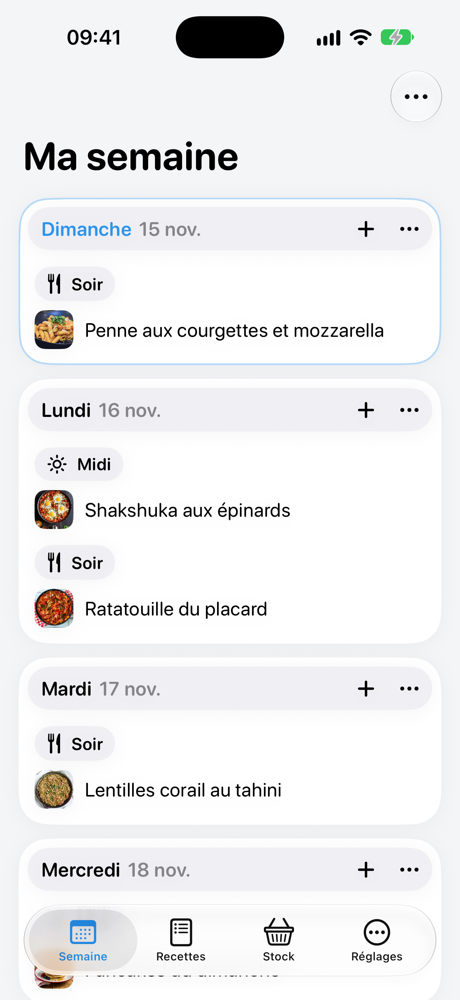
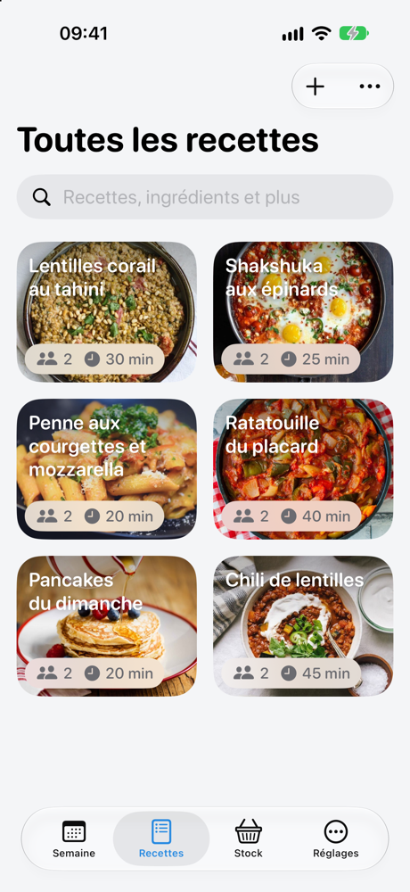
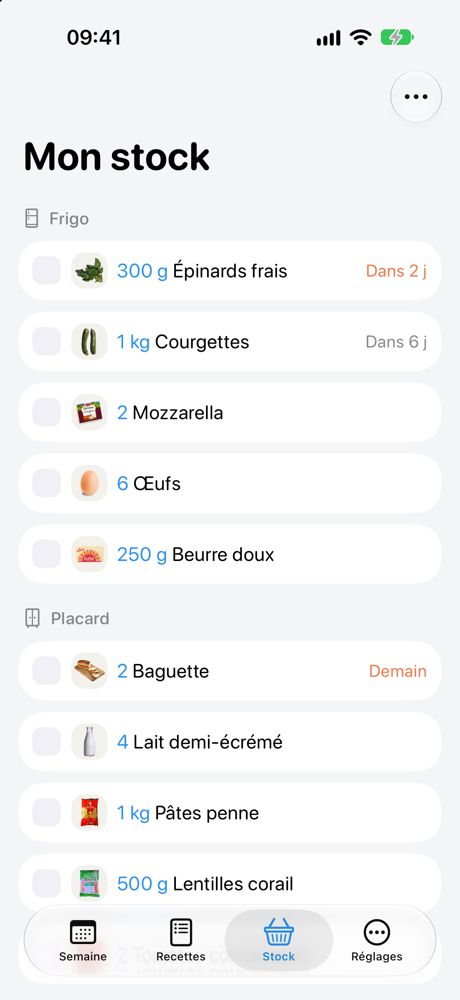

# Eathat

A zero-waste kitchen, run by Claude. Eathat tracks what is in the fridge, the cupboard and the freezer, what expires
first, and what to cook with it.

**The MCP server is the core of Eathat.** Claude is where you use the kitchen: you tell it what you bought, ate or
threw away, and ask it what to cook. It reads and changes the stock through the MCP tools, saves the recipes it
proposes and plans the week. The iPhone and iPad app is a window on the same data. It shows the stock, the recipes and
the week, and lets you tick things off.

```
Claude (any MCP client) ──MCP──▶ Cloudflare Worker ──▶ D1 (SQLite)
                                       ▲
iPhone / iPad app ─────REST────────────┘
```

The interface is in French. Eathat is built for one kitchen, so it has no accounts. Each deployment is its own
kitchen, protected by two secret keys.

<p align="center">
  
  
  
</p>

The screenshots use the app's made-up preview kitchen. Dish and ingredient photos come from
[TheMealDB](https://www.themealdb.com).

## The MCP server (`api/`)

This is a Cloudflare Worker with a D1 database. The MCP server speaks stateless Streamable HTTP and needs no SDK. It
answers at:

- `/mcp/{EATHAT_MCP_TOKEN}`, for clients that only take a URL, such as claude.ai connectors;
- `/mcp` with `Authorization: Bearer {EATHAT_MCP_TOKEN}`.

The server has 23 tools:

| Area | Tools |
|---|---|
| Context | `get_cooking_context` (stock, expiring items, preferences, the week's plan and rules for proposing a meal) |
| Stock | `list_inventory`, `get_expiring_soon`, `consume_item`, `mark_wasted`, `open_item`, `move_item`, `update_best_before` |
| What comes in | `add_stock_item`, `import_order` (an order and its lines, never imported twice), `remove_stock_item` |
| Recipes | `save_recipe`, `list_recipes`, `rate_recipe`, `log_meal`, `delete_recipe` |
| Week | `get_meal_plan`, `plan_meal`, `unplan_meal` |
| Photos | `find_photos` (real dish photos from TheMealDB), `set_image` |
| Preferences | `get_preferences`, `set_preference` |

Preferences such as household size, diet and dislikes are data in the `preferences` table, never rules in the code.
Money is stored in cents. Best-before dates are `YYYY-MM-DD` in Paris time.

The app has its own small REST API, authenticated with `Authorization: Bearer {EATHAT_API_KEY}`. It reuses the same
stock and recipe code as the MCP tools:

- `GET /v1/stock`, `GET /v1/recipes` and `GET /v1/preferences`;
- `GET|POST /v1/plan` and `DELETE /v1/plan/{id}`;
- `POST /v1/stock/{id}/consume|waste|open|move|best-before`;
- `POST /v1/recipes/{id}/cooked`.

### Deploy your own

```bash
cd api
npm install
cp wrangler.example.jsonc wrangler.jsonc
npx wrangler d1 create cuisine           # paste the database_id into wrangler.jsonc
npm run migrate                          # apply migrations/ to the remote database
npx wrangler secret put EATHAT_MCP_TOKEN # a long random string: anyone with it can change your stock
npx wrangler secret put EATHAT_API_KEY   # another one, for the app
npm run deploy
```

Then add the connector to Claude with the URL `https://eathat-api.<your-subdomain>.workers.dev/mcp/<EATHAT_MCP_TOKEN>`.
Treat that URL like a password.

To run it locally:

1. Put `EATHAT_MCP_TOKEN` and `EATHAT_API_KEY` in `api/.dev.vars`.
2. Run `npm run migrate:local`.
3. Optionally load the fictional sample data with `npx wrangler d1 execute cuisine --local --file seed.example.sql`.
4. Run `npx wrangler dev`.

## The app (`Eathat/`)

The app is written in SwiftUI for iOS 26 and Swift 6. It runs on iPhone in portrait and on iPad in every orientation,
where the tab bar becomes a sidebar. It has four tabs:

- **Semaine**, the planned meals for the next seven days;
- **Recettes**, the recipes Claude saved, with step-by-step cooking and timers;
- **Stock**, grouped by place, with what expires first on top;
- **Réglages**, the kitchen and its preferences.

The code follows an MV architecture: no view models, one `@Observable` store, and services behind protocols. Tests
come first and are written with Swift Testing. SwiftLint runs on every build and must stay clean.

```bash
cp Config/Secrets.example.xcconfig Config/Secrets.xcconfig   # your team, bundle id prefix, Worker URL and EATHAT_API_KEY
swiftlint lint
xcodebuild test -project Eathat.xcodeproj -scheme Eathat -destination 'platform=iOS Simulator,name=iPhone 17 Pro' -skipPackagePluginValidation
```

In Debug builds, launching with `-preview-kitchen` shows the built-in fictional data instead of your kitchen, and
`-startTab <0-3>` opens a given tab (how the screenshots above were taken).

## What stays private

Secrets and personal data never go into the repository:

- `.env`, `api/.dev.vars` and `Config/Secrets.xcconfig` hold the keys;
- `api/wrangler.jsonc` holds your D1 id;
- `api/seed.sql` holds your own starting stock.

All of these are gitignored. The repository ships `.example` versions instead.

## License

MIT, see [LICENSE](LICENSE).
